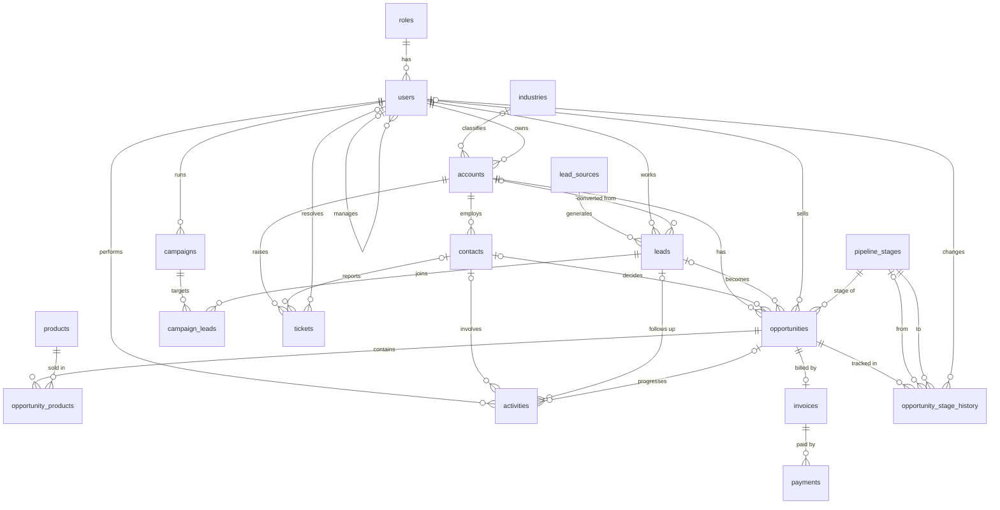
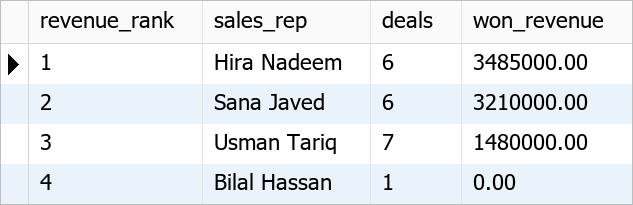
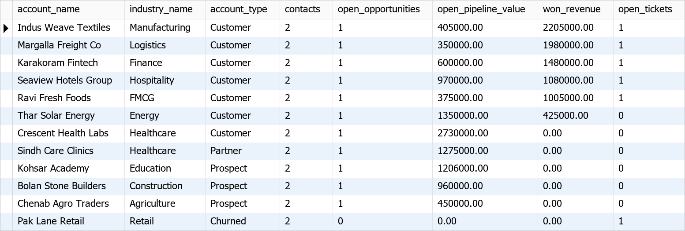

# PulseCRM

**A relational database for Customer Relationship Management, built in MySQL 8.0.**


PulseCRM stores everything a B2B sales and service team needs: leads, accounts, contacts, deals, products, activities, marketing campaigns, support tickets, invoices and payments. The design is normalized to 3NF. Business rules are enforced inside the database with constraints, a trigger and transaction-safe stored procedures.

> Final project for **Relational Database Management Systems (RDBMS)**, Postgraduate Diploma in Generative AI, NED University of Engineering & Technology, Karachi.

---

## Table of Contents

- [Project Information](#project-information)
- [Problem Statement](#problem-statement)
- [Key Features](#key-features)
- [Database at a Glance](#database-at-a-glance)
- [Entity Relationship Diagram](#entity-relationship-diagram)
- [Tables](#tables)
- [Repository Structure](#repository-structure)
- [Getting Started](#getting-started)
- [Views, Procedures and Trigger](#views-procedures-and-trigger)
- [Sample Results](#sample-results)
- [Data Integrity Tests](#data-integrity-tests)
- [Course Topics Covered](#course-topics-covered)
- [Future Work](#future-work)
- [Author](#author)
- [License](#license)

---

## Project Information

| | |
|---|---|
| **Project** | PulseCRM: Customer Relationship Management Database |
| **Student** | Iftikhar Ahmed (Student ID 311130) |
| **Course** | Relational Database Management Systems (RDBMS) |
| **Programme** | Postgraduate Diploma in Generative AI |
| **University** | NED University of Engineering & Technology, Karachi |
| **Instructor** | Sir Sajid |
| **Term** | Fall-I-2026 |
| **DBMS** | MySQL 8.0 (InnoDB, utf8mb4) |
| **Tools** | MySQL Workbench 8.0, Git, GitHub |

---

## Problem Statement

Small and mid-size companies often keep customer data in spreadsheets, e-mail threads and personal notebooks. The same customer appears with different spellings, deals are forgotten, support requests get lost, and management cannot see how much revenue is in the pipeline.

PulseCRM replaces those scattered sources with **one normalized relational database**:

- every customer, person and deal is stored **once** and connected through keys;
- the database itself **rejects invalid data** (wrong status, negative money, orphan records, duplicate e-mails);
- multi-step operations like converting a lead or recording a payment run as **atomic transactions**;
- managers get **ready-made reports** through views.

---

## Key Features

- **Lead management**: capture leads from six channels, score them 0–100 and convert them into an account, contact and opportunity with one procedure call.
- **Accounts and contacts**: companies classified by industry and type, with multiple contacts per account.
- **Sales pipeline**: six stages with win probability, weighted pipeline value and a full **stage history** written by a trigger.
- **Products and line items**: deal value is calculated from line items using a **generated column**.
- **Activities**: calls, e-mails, meetings, demos and tasks linked to a lead, contact or deal.
- **Marketing campaigns**: campaign budget, the leads reached and their response.
- **Customer support**: tickets with priority, status, resolution time and satisfaction score.
- **Billing**: one invoice per won deal, part payments, and status that follows the money received.
- **Reporting**: six views (Account 360, sales scorecard, lead conversion, pipeline, support and invoice balance).
- **Data integrity**: 18 primary keys, 31 foreign keys, 14 unique keys and 34 CHECK constraints.

---

## Database at a Glance

| Object | Count |
|---|---|
| Tables | 18 |
| Columns | 133 |
| Primary keys | 18 |
| Foreign keys | 31 |
| Unique keys | 14 |
| CHECK constraints | 34 |
| Secondary indexes | 7 |
| Views | 6 |
| Stored procedures | 5 |
| Triggers | 1 |
| Sample rows | 305 |

---

## Entity Relationship Diagram


The image omits the seven owner and assignee links to `users` to stay readable. The full diagram with every column and all 31 relationships is in **[docs/ERD.md](docs/ERD.md)**. A compact version is below, and GitHub draws it automatically:



---

## Tables

| Area | Table | Purpose |
|---|---|---|
| Administration | `roles` | Staff roles (Administrator, Sales, Marketing, Support) |
| | `users` | CRM staff, with a self-referencing manager |
| Accounts | `industries` | Lookup of business sectors |
| | `accounts` | Companies we sell to or work with |
| | `contacts` | People working at an account |
| Marketing | `lead_sources` | Lookup of lead channels |
| | `leads` | Potential customers before qualification |
| | `campaigns` | Marketing campaigns and budgets |
| | `campaign_leads` | Bridge: which leads each campaign reached |
| Sales | `pipeline_stages` | Pipeline stages with win probability |
| | `opportunities` | Deals moving through the pipeline |
| | `products` | Product and service catalogue |
| | `opportunity_products` | Bridge: deal line items with calculated totals |
| | `activities` | Calls, e-mails, meetings, demos and tasks |
| | `opportunity_stage_history` | Audit trail of stage changes |
| Support | `tickets` | Customer support cases |
| Billing | `invoices` | One invoice per won deal |
| | `payments` | Money received against invoices |

Column-level details for every table are in **[docs/DATA_DICTIONARY.md](docs/DATA_DICTIONARY.md)**.

---

## Repository Structure

```text
PulseCRM/
├── README.md                  Project overview (this file)
├── REQUIREMENTS.md            Software, functional and non-functional requirements
├── PROMPT.md                  Complete prompt used to generate the project
├── LICENSE                    MIT licence
├── .gitignore
├── database/
│   ├── pulse_crm.sql        ONE script: schema, constraints, indexes, sample data,
│   │                          views, trigger and stored procedures
│   └── queries.sql            32 report and demonstration queries
└── docs/
    ├── PROJECT_REPORT.md      Full university project report
    ├── ERD.md                 Mermaid ERD, notation and relationship list
    ├── erd.png / erd.svg      ERD image for presentations
    ├── DATA_DICTIONARY.md     Every table, column, key and constraint
    ├── QUERY_RESULTS.md       Each query with its real output
    └── screenshots/           Result grids for every query
```

---

## Getting Started

### Prerequisites

- MySQL Server **8.0.16 or later** (CHECK constraints are enforced from 8.0.16)
- MySQL Workbench 8.0, or the `mysql` command-line client

### 1. Clone the repository

```bash
git clone https://github.com/iftikhardba-svg/PulseCRM.git
```

### 2. Build the database

**MySQL Workbench:** open `database/pulse_crm.sql`, then run the whole script (lightning-bolt icon or `Ctrl+Shift+Enter`).

**Command line:**

```bash
mysql -u root -p < database/pulse_crm.sql
```

The script drops and re-creates the `pulse_crm` schema, so you can run it again at any time to reset the data. Its last statement prints the row count of each table: 18 tables, 305 rows in total.

### 3. Run the report and demo queries

Open `database/queries.sql` in Workbench and run the queries one section at a time.

- Sections 6 and 7 **change data**: they convert a lead, close a deal and record a payment. Rebuild the database with `pulse_crm.sql` before running them a second time.
- Section 7 statements are **expected to fail**. Workbench stops at the first error when it runs a whole script, so run those one at a time.

---

## Views, Procedures and Trigger

| Object | Type | What it does |
|---|---|---|
| `vw_sales_pipeline` | View | Every deal with account, owner, stage, probability and weighted value |
| `vw_account_360` | View | One row per account: contacts, open pipeline, won revenue and open tickets |
| `vw_sales_rep_performance` | View | Sales scorecard: leads, deals won/lost, revenue and win rate |
| `vw_lead_conversion_by_source` | View | Leads, conversions and conversion rate per channel |
| `vw_ticket_resolution` | View | Tickets with resolution time in hours |
| `vw_invoice_balance` | View | Invoice total, amount paid and balance due |
| `sp_convert_lead` | Procedure | Converts a lead into account + contact + opportunity in **one transaction** |
| `sp_update_opportunity_stage` | Procedure | Moves a deal; a won deal gets its invoice in the **same transaction** |
| `sp_record_payment` | Procedure | Records a payment, blocks overpayment, updates the invoice status |
| `sp_account_summary` | Procedure | Returns the Account 360 row and the open deals of an account |
| `sp_sales_rep_pipeline` | Procedure | Returns a rep's open and weighted pipeline through **OUT** parameters |
| `trg_opportunities_stage_history` | Trigger | Writes a history row every time a deal changes stage |

Every procedure that changes data uses `START TRANSACTION`, `COMMIT` and an `EXIT HANDLER` that runs `ROLLBACK` and re-raises the error, so a failed step never leaves half-saved data.

---

## Sample Results

All results come from running the queries on MySQL 8.0. Every query and its output is in **[docs/QUERY_RESULTS.md](docs/QUERY_RESULTS.md)**.

**Pipeline summary by stage (Q04)**


**Sales rep ranking with a CTE and `RANK()` (Q13)**



**Account 360 view (Q15)**



**Closing a deal: stage history written by the trigger (Q23)**


---

## Data Integrity Tests

Each test below was run against the database and rejected with the error shown:

| Test | Rule | MySQL response |
|---|---|---|
| Lead score of 150 | `chk_leads_score` (0–100) | Error 3819: Check constraint 'chk_leads_score' is violated |
| Duplicate contact e-mail | `uq_contacts_email` | Error 1062: Duplicate entry for key 'contacts.uq_contacts_email' |
| Deal for account 999 | `fk_opportunities_account` | Error 1452: Cannot add or update a child row |
| Delete an account still in use | foreign keys | Error 1451: Cannot delete or update a parent row |
| Pay more than the balance | `sp_record_payment` | Error 1644: Payment must be positive and cannot exceed the balance due |
| Closed Lost without a reason | `sp_update_opportunity_stage` | Error 1644: A loss reason is required for Closed Lost |
| Convert an unqualified lead | `sp_convert_lead` | Error 1644: Unqualified leads cannot be converted |

---

## Course Topics Covered

| Course topic | Where it appears in this project |
|---|---|
| Database design, entities and attributes | 18 entities identified from the CRM business process ([report](docs/PROJECT_REPORT.md)) |
| Primary and foreign keys, relationships | 31 foreign keys, 1:N, 1:1, M:N bridge tables and a self-reference |
| Normalization (1NF to 3NF) | Lookup and bridge tables, no repeating groups or transitive dependencies |
| DDL, constraints and ALTER/UPDATE/DELETE | `NOT NULL`, `DEFAULT`, `UNIQUE`, `CHECK`, `ON DELETE` rules |
| Aggregates, GROUP BY and HAVING | Queries Q04–Q06 and the reporting views |
| JOINs (INNER, LEFT, self join) | Queries Q01, Q07–Q10 |
| Subqueries, CTEs and views | Queries Q11–Q19, six views |
| Stored procedures, transactions and ACID | Five procedures, `SAVEPOINT` demo (Q25), trigger |
| Data quality | CHECK rules on every status and money field; generated column for line totals |

---

## Future Work

- Role-based database users with `GRANT`, plus a read-only reporting account
- A web front end (for example Flask or Laravel) on top of the procedures
- Scheduled events to mark invoices as overdue automatically
- Monthly sales targets per representative, and a dashboard in Power BI

---

## Author

**Iftikhar Ahmed**, Postgraduate Diploma in Generative AI, NED University of Engineering & Technology, Karachi

All companies, people, e-mail addresses and numbers in the sample data are fictional.

---

## License

This project is released under the [MIT License](LICENSE).
