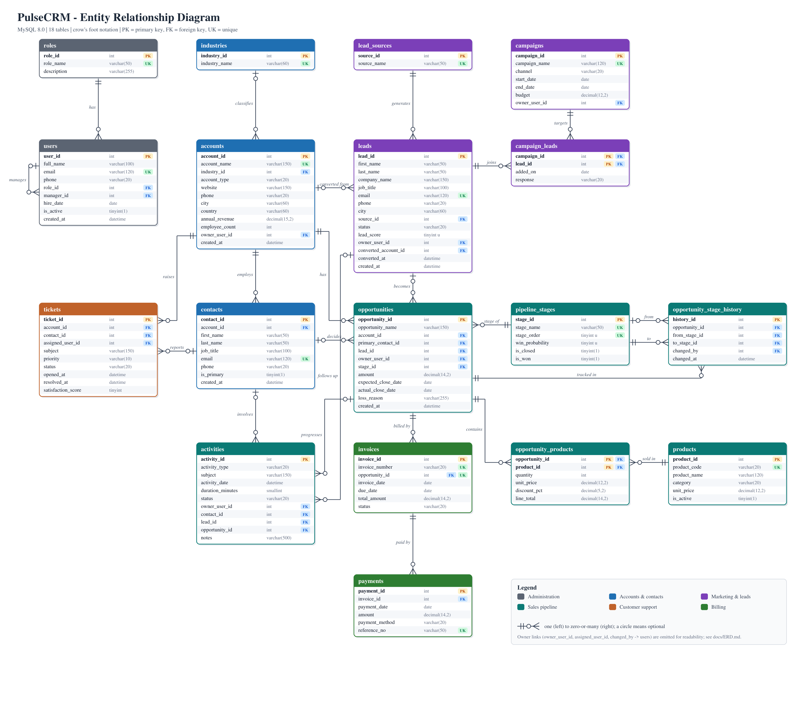
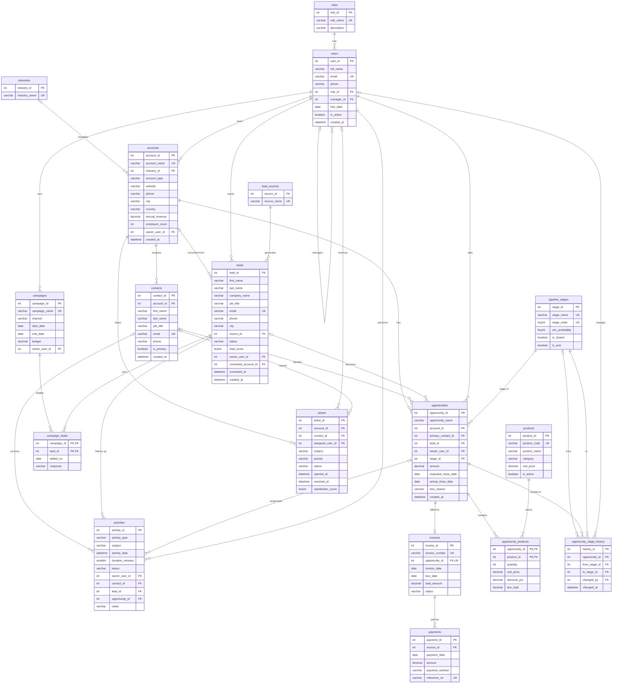

# Entity Relationship Diagram

PulseCRM has **18 tables** connected by **31 foreign keys**. The diagram is shown twice:

1. **Image** (`erd.png` / `erd.svg`), drawn for presentations. To keep it readable, the seven owner and assignee links to `users` are not drawn as lines.
2. **Mermaid** (below). GitHub renders it automatically, and it includes **every** relationship and column.

## Crow's foot notation

| Symbol | Meaning |
|---|---|
| `\|\|` | exactly one (mandatory parent) |
| `\|o` | zero or one (optional parent, the FK column allows NULL) |
| `o{` | zero or many children |
| `o\|` | zero or one child (one-to-one, the FK column is UNIQUE) |

## Full diagram (Mermaid)

## Relationship list

| Parent (one) | Child (many) | Foreign key | Cardinality | Parent link | ON DELETE |
|---|---|---|---|---|---|
| `industries` | `accounts` | `accounts.industry_id` → `industries.industry_id` | 1 : N | optional | NO ACTION |
| `users` | `accounts` | `accounts.owner_user_id` → `users.user_id` | 1 : N | required | NO ACTION |
| `contacts` | `activities` | `activities.contact_id` → `contacts.contact_id` | 1 : N | optional | NO ACTION |
| `leads` | `activities` | `activities.lead_id` → `leads.lead_id` | 1 : N | optional | NO ACTION |
| `opportunities` | `activities` | `activities.opportunity_id` → `opportunities.opportunity_id` | 1 : N | optional | NO ACTION |
| `users` | `activities` | `activities.owner_user_id` → `users.user_id` | 1 : N | required | NO ACTION |
| `campaigns` | `campaign_leads` | `campaign_leads.campaign_id` → `campaigns.campaign_id` | 1 : N | required | CASCADE |
| `leads` | `campaign_leads` | `campaign_leads.lead_id` → `leads.lead_id` | 1 : N | required | CASCADE |
| `users` | `campaigns` | `campaigns.owner_user_id` → `users.user_id` | 1 : N | required | NO ACTION |
| `accounts` | `contacts` | `contacts.account_id` → `accounts.account_id` | 1 : N | required | CASCADE |
| `opportunities` | `invoices` | `invoices.opportunity_id` → `opportunities.opportunity_id` | 1 : 0..1 | required | NO ACTION |
| `accounts` | `leads` | `leads.converted_account_id` → `accounts.account_id` | 1 : N | optional | NO ACTION |
| `users` | `leads` | `leads.owner_user_id` → `users.user_id` | 1 : N | required | NO ACTION |
| `lead_sources` | `leads` | `leads.source_id` → `lead_sources.source_id` | 1 : N | required | NO ACTION |
| `accounts` | `opportunities` | `opportunities.account_id` → `accounts.account_id` | 1 : N | required | NO ACTION |
| `contacts` | `opportunities` | `opportunities.primary_contact_id` → `contacts.contact_id` | 1 : N | optional | NO ACTION |
| `leads` | `opportunities` | `opportunities.lead_id` → `leads.lead_id` | 1 : N | optional | NO ACTION |
| `users` | `opportunities` | `opportunities.owner_user_id` → `users.user_id` | 1 : N | required | NO ACTION |
| `pipeline_stages` | `opportunities` | `opportunities.stage_id` → `pipeline_stages.stage_id` | 1 : N | required | NO ACTION |
| `opportunities` | `opportunity_products` | `opportunity_products.opportunity_id` → `opportunities.opportunity_id` | 1 : N | required | CASCADE |
| `products` | `opportunity_products` | `opportunity_products.product_id` → `products.product_id` | 1 : N | required | NO ACTION |
| `pipeline_stages` | `opportunity_stage_history` | `opportunity_stage_history.from_stage_id` → `pipeline_stages.stage_id` | 1 : N | optional | NO ACTION |
| `opportunities` | `opportunity_stage_history` | `opportunity_stage_history.opportunity_id` → `opportunities.opportunity_id` | 1 : N | required | CASCADE |
| `pipeline_stages` | `opportunity_stage_history` | `opportunity_stage_history.to_stage_id` → `pipeline_stages.stage_id` | 1 : N | required | NO ACTION |
| `users` | `opportunity_stage_history` | `opportunity_stage_history.changed_by` → `users.user_id` | 1 : N | optional | SET NULL |
| `invoices` | `payments` | `payments.invoice_id` → `invoices.invoice_id` | 1 : N | required | NO ACTION |
| `accounts` | `tickets` | `tickets.account_id` → `accounts.account_id` | 1 : N | required | NO ACTION |
| `users` | `tickets` | `tickets.assigned_user_id` → `users.user_id` | 1 : N | optional | NO ACTION |
| `contacts` | `tickets` | `tickets.contact_id` → `contacts.contact_id` | 1 : N | optional | NO ACTION |
| `users` | `users` | `users.manager_id` → `users.user_id` | 1 : N | optional | SET NULL |
| `roles` | `users` | `users.role_id` → `roles.role_id` | 1 : N | required | NO ACTION |

## Design notes

- **Many-to-many relationships** are resolved with bridge tables that use composite primary keys:
  - `opportunity_products`: deals ↔ products
  - `campaign_leads`: campaigns ↔ leads
- **One-to-one:** `invoices.opportunity_id` is `UNIQUE`, so a won deal is billed exactly once.
- **Self-reference:** `users.manager_id` → `users.user_id` stores the reporting line.
- **Two relationships between the same pair of tables:** `opportunity_stage_history` refers to `pipeline_stages` twice, once for the `from_stage_id` and once for the `to_stage_id` of a change.
- **Lookup tables** (`roles`, `industries`, `lead_sources`, `pipeline_stages`) keep repeated text out of the main tables and give one place to change a value.
