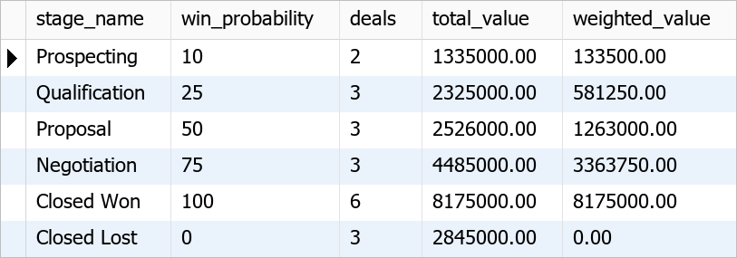
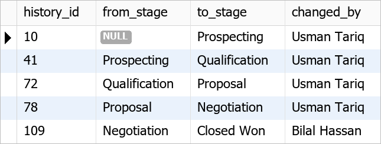

# PulseCRM: Project Report

**Customer Relationship Management Database in MySQL 8.0**

| | |
|---|---|
| **Student** | Iftikhar Ahmed (Student ID 311130) |
| **Course** | Relational Database Management Systems (RDBMS) |
| **Programme** | Postgraduate Diploma in Generative AI |
| **University** | NED University of Engineering & Technology, Karachi |
| **Instructor** | Sir Sajid |
| **Term** | Fall-I-2026 |

---

## Abstract

PulseCRM is a relational database that supports the full customer life cycle of a B2B technology services company:

- capturing and scoring leads;
- converting them into accounts, contacts and opportunities;
- moving deals through a sales pipeline;
- logging activities and running campaigns;
- handling support tickets;
- invoicing won deals and collecting payments.

The schema has **18 tables in third normal form**, connected by **31 foreign keys** and protected by **34 CHECK constraints** and **14 unique keys**. Reporting is provided by **six views**, and business processes that change several tables are implemented as **five stored procedures with transactions**. A **trigger** keeps an audit trail of pipeline changes.

The database was built from a single SQL script and loaded with 305 rows of fictional sample data. It was then tested with 32 queries, including seven integrity tests, all of which were rejected as expected.

---

## 1. Introduction

### 1.1 Background

A Customer Relationship Management (CRM) system is where a company keeps the history of every customer: who they are, what was discussed, what they bought, what they still owe and what problems they reported. Without one, this information sits in spreadsheets and e-mail, where it is duplicated, inconsistent and hard to report on.

### 1.2 Problem statement

The fictional company that will use PulseCRM keeps its sales data in shared spreadsheets. The team reported these problems:

- the same customer is typed with different spellings in different sheets;
- nobody knows the total value of open deals, or which sales representative is performing best;
- leads are forgotten after the first call;
- invoices and payments are tracked separately from the deals they belong to;
- support tickets have no owner, and nobody measures response time.

### 1.3 Objectives

1. Design a normalized relational schema (3NF) for the complete CRM process.
2. Enforce business rules inside the database with keys, CHECK constraints, a trigger and transactions.
3. Load realistic sample data and prove the design with report queries.
4. Provide reusable reports through views and stored procedures.
5. Document the design (ERD, data dictionary, requirements) in a GitHub-ready repository.

### 1.4 Scope

The project covers the database layer only: schema, data, views, procedures, trigger, queries and documentation. A user interface, e-mail integration and online payments are outside the scope.

---

## 2. Requirements

The full specification is in [REQUIREMENTS.md](../REQUIREMENTS.md). In summary:

- **34 functional requirements**: users, accounts, leads, pipeline, activities, support, billing and reporting.
- **10 non-functional requirements**: integrity, ACID, auditability, performance and maintainability.
- **10 business rules**, each traced to the constraint or procedure that enforces it.

---

## 3. Methodology

The project followed the standard database design life cycle taught in the course:

| Phase | Output |
|---|---|
| 1. Requirements analysis | Business process, user roles, functional requirements and business rules |
| 2. Conceptual design | Entities, attributes and relationships (ERD) |
| 3. Logical design | Relational schema, keys and normalization to 3NF |
| 4. Physical design | MySQL data types, constraints, indexes, generated column |
| 5. Implementation | `pulse_crm.sql`: tables, data, views, trigger, procedures |
| 6. Testing | `queries.sql`: 25 report and procedure queries plus 7 integrity tests |
| 7. Documentation | README, ERD, data dictionary, requirements, this report |

---

## 4. Conceptual Design

### 4.1 Identifying entities

The entities were found by underlining the nouns in the business process:

> "A **lead** from a **lead source** is assigned to a **sales representative** (**user** with a **role**). When qualified, the lead becomes an **account** in an **industry**, with **contacts**, and an **opportunity** that moves through **pipeline stages** and contains **products**. Staff log **activities**, marketing runs **campaigns**, customers raise support **tickets**, and won deals are **invoiced** and **paid**."

This gave 14 core entities. Four more tables were added during the design:
- two **bridge tables** for many-to-many relationships (`opportunity_products`, `campaign_leads`);
- an **audit table** (`opportunity_stage_history`);
- a separate **payments** table, so an invoice can be paid in instalments.

### 4.2 Relationships and cardinality

| Relationship | Cardinality | How it is implemented |
|---|---|---|
| Role → User | 1 : N | `users.role_id` |
| User → User (manager) | 1 : N, recursive | `users.manager_id` |
| Industry → Account | 1 : N (optional) | `accounts.industry_id` |
| Account → Contact | 1 : N | `contacts.account_id` |
| Lead source → Lead | 1 : N | `leads.source_id` |
| Account → Lead (converted) | 1 : N (optional) | `leads.converted_account_id` |
| Account → Opportunity | 1 : N | `opportunities.account_id` |
| Stage → Opportunity | 1 : N | `opportunities.stage_id` |
| Opportunity ↔ Product | M : N | bridge `opportunity_products` |
| Campaign ↔ Lead | M : N | bridge `campaign_leads` |
| Opportunity → Invoice | 1 : 1 | `invoices.opportunity_id` is UNIQUE |
| Invoice → Payment | 1 : N | `payments.invoice_id` |
| Opportunity → Stage history | 1 : N | `opportunity_stage_history.opportunity_id` |

### 4.3 Entity Relationship Diagram


The complete Mermaid ERD with all 31 relationships is in [ERD.md](ERD.md).

---

## 5. Logical Design and Normalization

### 5.1 Starting point: one flat sheet (UNF)

The old spreadsheet stored each deal on one row:

| deal | customer | customer_city | contact_names | contact_emails | owner | owner_role | products | stage | probability | invoice_no | payments |
|---|---|---|---|---|---|---|---|---|---|---|---|
| ERP Rollout | Indus Weave Textiles | Faisalabad | Asif Mahmood, Rabia Anwar | asif@…, rabia@… | Sana Javed | Sales Rep | Cloud ERP; CRM Impl; Training x4 | Closed Won | 100 | INV-2026-0401 | 2,205,000 on 20-Apr |

It has these problems:

- **Repeating groups:** `contact_names`, `products` and `payments` hold lists in a single cell.
- **Update anomaly:** a customer's city is repeated on every deal, so changing it means editing many rows.
- **Insert anomaly:** a new product cannot be added until someone sells it.
- **Delete anomaly:** deleting the only deal of a customer also deletes the customer.

### 5.2 First normal form (1NF)

Every cell must hold one atomic value. The repeating lists move to their own rows: one row per contact, per product line and per payment. Each table gets a primary key.

### 5.3 Second normal form (2NF)

In the line-item table the key is `(opportunity_id, product_id)`, but `product_name` and `list price` depend only on `product_id`, which is a partial dependency. Product details therefore move to `products`. Only the facts that depend on the whole key (`quantity`, agreed `unit_price`, `discount_pct`) stay in `opportunity_products`.

### 5.4 Third normal form (3NF)

Transitive dependencies are removed:

- `owner_role` depends on the owner, not the deal → `users.role_id` → `roles`
- `probability` depends on the stage, not the deal → `pipeline_stages.win_probability`
- `customer_city` depends on the customer → `accounts.city`
- source name and industry name → lookup tables `lead_sources` and `industries`

### 5.5 Deliberate design choices

- `opportunities.amount` stores the sum of the line items. It is set from `opportunity_products.line_total`, which is calculated by MySQL as a **stored generated column**, so a line total can never disagree with its quantity, price and discount.
- `invoices.total_amount` copies the deal amount at the moment of invoicing. An invoice is a legal document, so it must not change if the deal is edited later.

---

## 6. Physical Design

| Decision | Reason |
|---|---|
| InnoDB engine | Foreign keys, row-level locking and transactions |
| utf8mb4 character set | Names in any language |
| `INT AUTO_INCREMENT` surrogate keys | Stable, compact keys; natural keys (e-mail, product code, invoice number) are kept as `UNIQUE` |
| `DECIMAL(14,2)` for money | Exact arithmetic, no floating-point rounding |
| `BOOLEAN` flags (`is_active`, `is_closed`, `is_won`) | Simple filters in views |
| `VARCHAR` + `CHECK (... IN (...))` for statuses | Readable values, enforced like an enum, easy to extend |
| `ON DELETE CASCADE` only on dependent rows | Line items, contacts, history and campaign members disappear with their parent |
| `ON DELETE SET NULL` on `users.manager_id` and `history.changed_by` | Removing a person keeps the records they touched |
| Default `RESTRICT` everywhere else | Accounts, deals and invoices cannot be deleted while they are in use |
| Secondary indexes | `leads(status, lead_score)`, `opportunities(expected_close_date)`, `tickets(status, priority)`, `invoices(status, due_date)`, `activities(activity_date, status)`, `accounts(account_type, city)`, `history(changed_at)` |

Every column carries a `COMMENT`, and the [data dictionary](DATA_DICTIONARY.md) is generated from those comments.

---

## 7. Implementation

### 7.1 One build script

`database/pulse_crm.sql` builds the whole database in this order:

1. drop and create the schema;
2. 18 tables with all constraints;
3. secondary indexes;
4. sample data;
5. views;
6. trigger;
7. stored procedures;
8. a verification query.

The script can be run any number of times.

The sample data is internally consistent:
- deal amounts are calculated from line items;
- invoice totals are taken from the won deals;
- invoice statuses are derived from the payments;
- the stage history is generated from each deal's dates.

### 7.2 Views

| View | Purpose |
|---|---|
| `vw_sales_pipeline` | Deals with account, owner, stage, probability and weighted value |
| `vw_account_360` | One row per customer: contacts, open deals, won revenue, open tickets |
| `vw_sales_rep_performance` | Leads, deals won/lost, revenue and win rate per representative |
| `vw_lead_conversion_by_source` | Conversion rate by lead channel |
| `vw_ticket_resolution` | Resolution time of each ticket |
| `vw_invoice_balance` | Paid amount and balance due of each invoice |

`vw_account_360` and `vw_sales_rep_performance` **pre-aggregate** each child table in a derived table before joining. Joining contacts, deals and tickets directly would multiply the rows and inflate the totals.

### 7.3 Stored procedures and transactions

Every procedure that changes data follows the same pattern:

```sql
DECLARE EXIT HANDLER FOR SQLEXCEPTION
BEGIN
    ROLLBACK;     -- undo the partial work
    RESIGNAL;     -- report the original error to the caller
END;

START TRANSACTION;
    -- validate with SELECT ... FOR UPDATE, SIGNAL on bad input
    -- several INSERT / UPDATE statements
COMMIT;
```

| Procedure | Tables changed in one transaction |
|---|---|
| `sp_convert_lead` | `accounts` (if new), `contacts`, `opportunities`, `opportunity_stage_history`, `leads` |
| `sp_update_opportunity_stage` | `opportunities`, `opportunity_stage_history` (trigger), `invoices` (when won) |
| `sp_record_payment` | `payments`, `invoices` |

`sp_account_summary` (two result sets) and `sp_sales_rep_pipeline` (two **OUT** parameters) are read-only reporting procedures.

### 7.4 Trigger

`trg_opportunities_stage_history` runs `AFTER UPDATE` on `opportunities`. When `stage_id` changes, it inserts a history row. The procedure sets the session variable `@crm_user_id` first, so the trigger can record who made the change.

### 7.5 ACID in this project

| Property | Example |
|---|---|
| **Atomicity** | Lead conversion creates the account, contact and deal and updates the lead together, or not at all |
| **Consistency** | CHECK and FK constraints mean every committed state obeys the business rules |
| **Isolation** | `SELECT ... FOR UPDATE` locks the invoice so two payments cannot both pass the balance check |
| **Durability** | InnoDB writes committed transactions to its redo log |

---

## 8. Testing and Results

All 32 queries in `database/queries.sql` were run on MySQL 8.0.46. The real output of each one is in [QUERY_RESULTS.md](QUERY_RESULTS.md).

### 8.1 Functional tests

| Query | What it proves | Result |
|---|---|---|
| Q04 | Pipeline totals per stage | 6 won deals worth PKR 8,175,000; open pipeline PKR 10,671,000 |
| Q13 | CTE and window function | Hira Nadeem ranked first by won revenue |
| Q15 | Account 360 view | Indus Weave Textiles has the highest won revenue (PKR 2,205,000) |
| Q19 | Outstanding invoices | 3 invoices with a balance due, 1 of them overdue |
| Q22 | `sp_convert_lead` | Lead 307 became account 113, contact 225 and opportunity 421 in one transaction |
| Q23 | Stage procedure, trigger and auto invoice | History row "Negotiation → Closed Won by Bilal Hassan" and invoice INV-2026-0410 created |
| Q24 | `sp_record_payment` | Invoice status changed from Unpaid to Partially Paid |
| Q25 | `SAVEPOINT` | Partial rollback kept the training price change; the final `ROLLBACK` restored the original prices |





### 8.2 Integrity tests (all rejected, as expected)

| Query | Attempt | MySQL error |
|---|---|---|
| Q26 | Lead score 150 | 3819: Check constraint 'chk_leads_score' is violated |
| Q27 | Duplicate contact e-mail | 1062: Duplicate entry … for key 'contacts.uq_contacts_email' |
| Q28 | Deal for account 999 | 1452: Cannot add or update a child row (fk_opportunities_account) |
| Q29 | Delete account 101 | 1451: Cannot delete or update a parent row |
| Q30 | Overpay an invoice | 1644: Payment must be positive and cannot exceed the balance due |
| Q31 | Closed Lost with no reason | 1644: A loss reason is required for Closed Lost |
| Q32 | Convert an unqualified lead | 1644: Unqualified leads cannot be converted |

Q29 is a useful lesson. Account 101's contacts are set to `ON DELETE CASCADE`, so MySQL first tries to delete them as well. Activities and deals still reference those contacts, so the foreign key `fk_activities_contact` stops the whole statement, and **nothing** is deleted.

---

## 9. Discussion

**What worked well**
- Business rules sit in the database, so any future application inherits them for free.
- The generated `line_total` column removed a whole class of calculation errors.
- Pre-aggregating in views avoided the classic "join fan-out" bug in totals.

**Challenges**
- MySQL does not allow a CHECK constraint on a column that also has a foreign-key referential action. For example, `activities` checks that at least one of `contact_id`, `lead_id` or `opportunity_id` is set, so those foreign keys use the default `RESTRICT` instead of `SET NULL`.
- A CHECK constraint cannot use non-deterministic functions such as `CURDATE()`. Rules that depend on today's date (overdue invoices) are therefore applied in queries and procedures, not as constraints.
- A trigger cannot know which application user made a change. A session variable (`@crm_user_id`), set by the procedure, solves this.

---

## 10. Conclusion and Future Work

PulseCRM meets all its objectives:
- the schema is normalized and documented;
- 79 constraints protect the data (34 CHECK, 31 foreign keys and 14 unique keys);
- views give management the reports they asked for;
- transactional procedures make the main business processes safe.

All acceptance tests passed.

**Future work**
- Role-based MySQL accounts with `GRANT` and a read-only reporting user.
- A scheduled `EVENT` that marks unpaid invoices as overdue every night.
- Monthly sales targets and a Power BI dashboard on top of the views.
- A web front end that calls the stored procedures.

---

## References

1. MySQL 8.0 Reference Manual: CREATE TABLE, CHECK constraints, generated columns, stored procedures, triggers. Oracle Corporation.
2. Elmasri, R. & Navathe, S. *Fundamentals of Database Systems*, 7th ed. Pearson.
3. Connolly, T. & Begg, C. *Database Systems: A Practical Approach to Design, Implementation and Management*, 6th ed. Pearson.
4. RDBMS lecture and lab material, Weeks 1–7, NED University of Engineering & Technology, Karachi.

---

## Appendix A: How to Reproduce

```bash
mysql -u root -p < database/pulse_crm.sql   # build and load (prints 18 tables / 305 rows)
mysql -u root -p pulse_crm < database/queries.sql --force   # run all demos (7 expected errors)
```

## Appendix B: Presentation Outline (10 slides)

1. **Title**: PulseCRM, student, course, instructor
2. **Problem**: spreadsheet chaos (duplicates, lost leads, no pipeline view)
3. **Objectives and scope**
4. **Requirements**: user roles, key functional requirements, business rules
5. **ERD**: 18 tables, colour-coded by business area
6. **Normalization**: flat sheet → 1NF → 2NF → 3NF, with the anomalies removed
7. **Implementation**: constraints, generated column, views, trigger
8. **Transactions**: lead conversion and closing a deal (live demo of Q22 and Q23)
9. **Results**: pipeline, sales ranking, Account 360, integrity tests
10. **Conclusion and future work**
