# Query Results

Every query in [`database/queries.sql`](../database/queries.sql) was run on MySQL 8.0 against the sample data from [`database/pulse_crm.sql`](../database/pulse_crm.sql). The images are the actual result grids.

## 1. Basic Retrieval and Filtering

### Q01: Staff Directory with Role and Manager

List all active staff with their role and line manager (self join on users).

```sql
-- Q01: active staff, role and manager
SELECT u.user_id,
       u.full_name,
       r.role_name,
       COALESCE(m.full_name, '-') AS manager
FROM users u
JOIN roles r       ON u.role_id = r.role_id
LEFT JOIN users m  ON u.manager_id = m.user_id
WHERE u.is_active = TRUE
ORDER BY r.role_id, u.full_name;
```

*Active staff, role and manager*

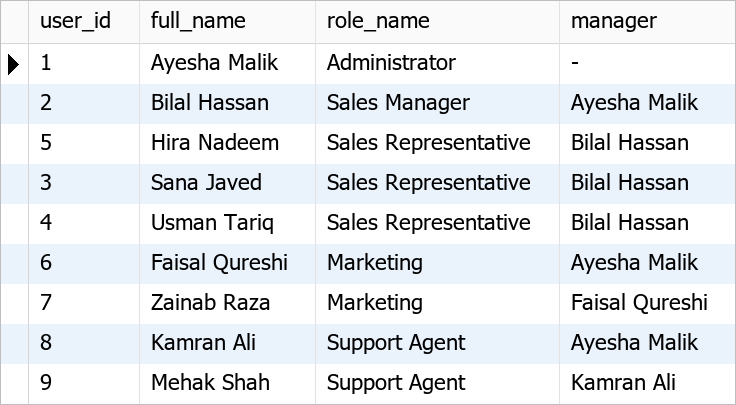

### Q02: Customer Accounts in Karachi or Islamabad

Show customer accounts located in Karachi or Islamabad, largest annual revenue first.

```sql
-- Q02: customers in two cities
SELECT account_id,
       account_name,
       city,
       annual_revenue,
       employee_count
FROM accounts
WHERE account_type = 'Customer'
  AND city IN ('Karachi', 'Islamabad')
ORDER BY annual_revenue DESC;
```

*Customers in two cities*

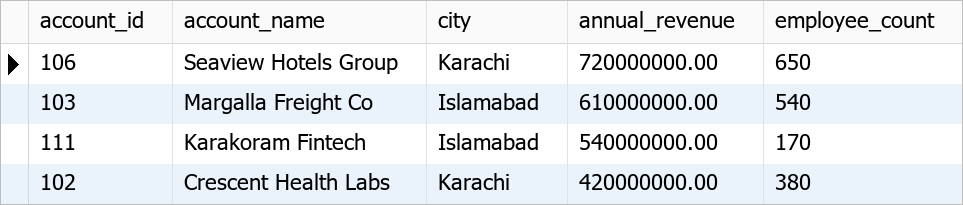

### Q03: Hot Leads

Find open leads (New, Contacted or Qualified) with a lead score of 60 or more.

```sql
-- Q03: open leads with a high score
SELECT lead_id,
       CONCAT(first_name, ' ', last_name) AS lead_name,
       company_name,
       city,
       status,
       lead_score
FROM leads
WHERE status IN ('New', 'Contacted', 'Qualified')
  AND lead_score >= 60
ORDER BY lead_score DESC;
```

*Open leads with a high score*

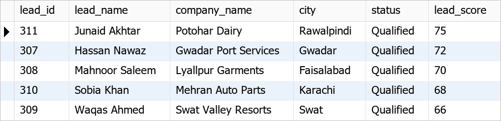


## 2. Aggregate Functions, GROUP BY and HAVING

### Q04: Pipeline Summary by Stage

Count deals and total their value and weighted value for every pipeline stage.

```sql
-- Q04: pipeline by stage
SELECT s.stage_name,
       s.win_probability,
       COUNT(o.opportunity_id)                              AS deals,
       COALESCE(SUM(o.amount), 0)                           AS total_value,
       ROUND(COALESCE(SUM(o.amount), 0) * s.win_probability / 100, 2) AS weighted_value
FROM pipeline_stages s
LEFT JOIN opportunities o ON o.stage_id = s.stage_id
GROUP BY s.stage_id, s.stage_name, s.win_probability, s.stage_order
ORDER BY s.stage_order;
```

*Pipeline by stage*


### Q05: Busy Lead Sources

Show lead sources that produced at least 4 leads, with their average lead score.

```sql
-- Q05: lead sources with 4 or more leads (HAVING)
SELECT ls.source_name,
       COUNT(*)                     AS total_leads,
       ROUND(AVG(l.lead_score), 1)  AS avg_score
FROM leads l
JOIN lead_sources ls ON l.source_id = ls.source_id
GROUP BY ls.source_id, ls.source_name
HAVING COUNT(*) >= 4
ORDER BY total_leads DESC, avg_score DESC;
```

*Lead sources with 4 or more leads (HAVING)*

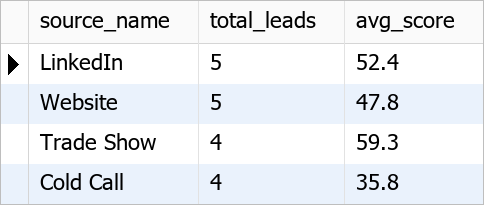

### Q06: Monthly Won Revenue in 2026

Total the value of deals won in each month of 2026.

```sql
-- Q06: won revenue per month
SELECT DATE_FORMAT(o.actual_close_date, '%Y-%m') AS close_month,
       COUNT(*)                                  AS deals_won,
       SUM(o.amount)                             AS won_revenue
FROM opportunities o
JOIN pipeline_stages s ON o.stage_id = s.stage_id
WHERE s.is_won = TRUE
  AND YEAR(o.actual_close_date) = 2026
GROUP BY close_month
ORDER BY close_month;
```

*Won revenue per month*

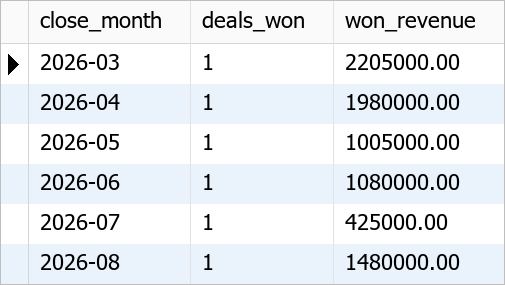


## 3. JOINs Across Related Tables

### Q07: Open Deals with Account, Contact and Owner

Join opportunities, accounts, contacts, users and stages to list every open deal.

```sql
-- Q07: open pipeline (five-table join)
SELECT o.opportunity_id,
       o.opportunity_name,
       a.account_name,
       CONCAT(c.first_name, ' ', c.last_name) AS primary_contact,
       u.full_name                            AS owner,
       s.stage_name,
       o.amount,
       o.expected_close_date
FROM opportunities o
JOIN accounts a         ON o.account_id = a.account_id
LEFT JOIN contacts c    ON o.primary_contact_id = c.contact_id
JOIN users u            ON o.owner_user_id = u.user_id
JOIN pipeline_stages s  ON o.stage_id = s.stage_id
WHERE s.is_closed = FALSE
ORDER BY o.expected_close_date;
```

*Open pipeline (five-table join)*

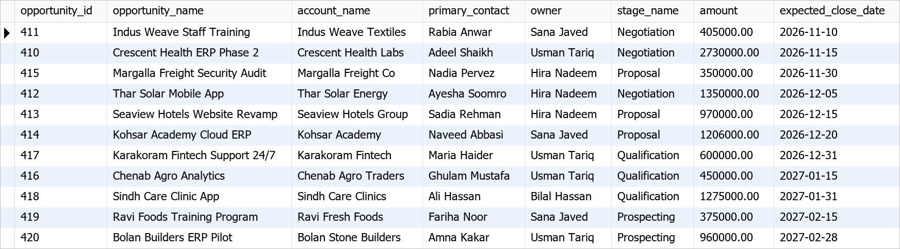

### Q08: Accounts without Support Tickets

Find accounts that have never raised a support ticket (LEFT JOIN ... IS NULL).

```sql
-- Q08: accounts with no tickets
SELECT a.account_id,
       a.account_name,
       a.account_type
FROM accounts a
LEFT JOIN tickets t ON a.account_id = t.account_id
WHERE t.ticket_id IS NULL
ORDER BY a.account_name;
```

*Accounts with no tickets*

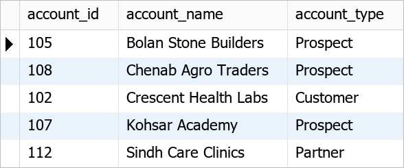

### Q09: Product Revenue from Won Deals

Rank products by the revenue they brought in from won deals.

```sql
-- Q09: revenue per product (won deals only)
SELECT p.product_code,
       p.product_name,
       p.category,
       SUM(op.quantity)   AS units_sold,
       SUM(op.line_total) AS won_revenue
FROM opportunity_products op
JOIN products p         ON op.product_id = p.product_id
JOIN opportunities o    ON op.opportunity_id = o.opportunity_id
JOIN pipeline_stages s  ON o.stage_id = s.stage_id
WHERE s.is_won = TRUE
GROUP BY p.product_id, p.product_code, p.product_name, p.category
ORDER BY won_revenue DESC;
```

*Revenue per product (won deals only)*

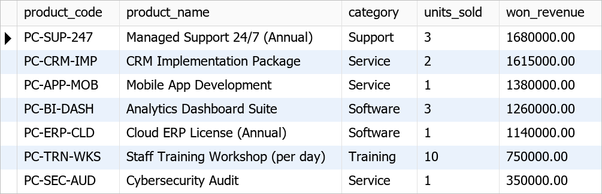

### Q10: Campaign Effectiveness

For each campaign show leads reached, leads that responded, leads converted and cost per lead.

```sql
-- Q10: campaign results
SELECT c.campaign_name,
       c.channel,
       c.budget,
       COUNT(cl.lead_id)                                         AS leads_reached,
       SUM(CASE WHEN cl.response = 'Responded' THEN 1 ELSE 0 END) AS responded,
       SUM(CASE WHEN l.status = 'Converted' THEN 1 ELSE 0 END)    AS converted,
       ROUND(c.budget / NULLIF(COUNT(cl.lead_id), 0), 2)          AS cost_per_lead
FROM campaigns c
LEFT JOIN campaign_leads cl ON c.campaign_id = cl.campaign_id
LEFT JOIN leads l           ON cl.lead_id = l.lead_id
GROUP BY c.campaign_id, c.campaign_name, c.channel, c.budget
ORDER BY converted DESC, responded DESC;
```

*Campaign results*

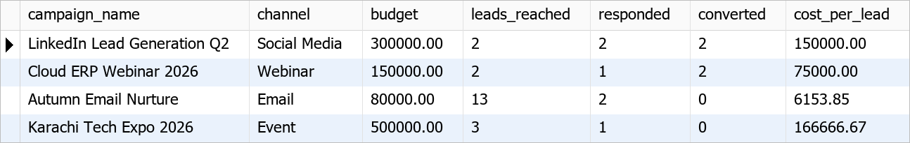


## 4. Subqueries, CTEs and Window Functions

### Q11: Accounts above Average Won Revenue

Find accounts whose won revenue is greater than the average won revenue of accounts that have won deals.

```sql
-- Q11: subquery against an average
SELECT account_name,
       won_revenue
FROM vw_account_360
WHERE won_revenue > (SELECT AVG(won_revenue)
                     FROM vw_account_360
                     WHERE won_revenue > 0)
ORDER BY won_revenue DESC;
```

*Subquery against an average*

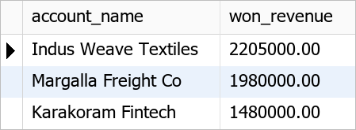

### Q12: Open Leads Never Contacted

List open leads that have no activity logged against them (NOT EXISTS).

```sql
-- Q12: open leads with no activity
SELECT l.lead_id,
       CONCAT(l.first_name, ' ', l.last_name) AS lead_name,
       l.company_name,
       l.status,
       l.lead_score
FROM leads l
WHERE l.status IN ('New', 'Contacted', 'Qualified')
  AND NOT EXISTS (SELECT 1
                  FROM activities a
                  WHERE a.lead_id = l.lead_id)
ORDER BY l.lead_score DESC;
```

*Open leads with no activity*

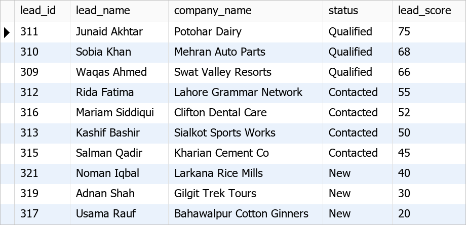

### Q13: Sales Rep Ranking

Use a CTE and RANK() to rank sales staff by won revenue.

```sql
-- Q13: CTE + window function
WITH rep_revenue AS (
    SELECT u.full_name AS sales_rep,
           SUM(CASE WHEN s.is_won = TRUE THEN o.amount ELSE 0 END) AS won_revenue,
           COUNT(o.opportunity_id)                                 AS deals
    FROM users u
    JOIN opportunities o   ON o.owner_user_id = u.user_id
    JOIN pipeline_stages s ON o.stage_id = s.stage_id
    GROUP BY u.user_id, u.full_name
)
SELECT RANK() OVER (ORDER BY won_revenue DESC) AS revenue_rank,
       sales_rep,
       deals,
       won_revenue
FROM rep_revenue
ORDER BY revenue_rank;
```

*CTE + window function*


### Q14: Average Sales Cycle

Using a CTE, compare the average number of days from creation to close for won and lost deals.

```sql
-- Q14: sales cycle in days
WITH closed_deals AS (
    SELECT s.stage_name,
           DATEDIFF(o.actual_close_date, DATE(o.created_at)) AS cycle_days,
           o.amount
    FROM opportunities o
    JOIN pipeline_stages s ON o.stage_id = s.stage_id
    WHERE s.is_closed = TRUE
)
SELECT stage_name,
       COUNT(*)                 AS deals,
       ROUND(AVG(cycle_days), 1) AS avg_cycle_days,
       MIN(cycle_days)          AS shortest,
       MAX(cycle_days)          AS longest
FROM closed_deals
GROUP BY stage_name;
```

*Sales cycle in days*

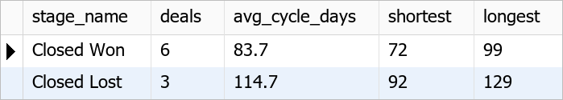


## 5. Reporting Views

### Q15: Account 360 View

Show the top accounts from vw_account_360, ordered by won revenue.

```sql
-- Q15: account 360
SELECT account_name,
       industry_name,
       account_type,
       contacts,
       open_opportunities,
       open_pipeline_value,
       won_revenue,
       open_tickets
FROM vw_account_360
ORDER BY won_revenue DESC, open_pipeline_value DESC;
```

*Account 360*


### Q16: Sales Rep Scorecard

Show the sales team scorecard from vw_sales_rep_performance.

```sql
-- Q16: sales scorecard
SELECT sales_rep,
       leads_owned,
       leads_converted,
       opportunities,
       won_deals,
       lost_deals,
       won_revenue,
       open_pipeline,
       win_rate_pct
FROM vw_sales_rep_performance
ORDER BY won_revenue DESC;
```

*Sales scorecard*

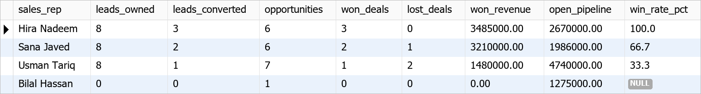

### Q17: Lead Conversion by Source

Show conversion rate by lead source from vw_lead_conversion_by_source.

```sql
-- Q17: lead conversion
SELECT *
FROM vw_lead_conversion_by_source
ORDER BY conversion_rate_pct DESC, total_leads DESC;
```

*Lead conversion*

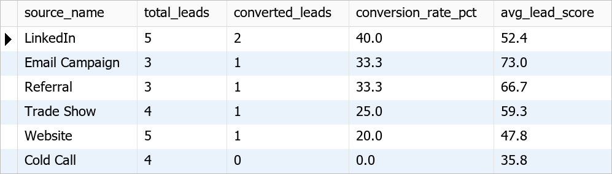

### Q18: Support Resolution Time by Priority

Average resolution hours and customer satisfaction per ticket priority, from vw_ticket_resolution.

```sql
-- Q18: support performance
SELECT priority,
       COUNT(*)                           AS tickets,
       SUM(CASE WHEN resolved_at IS NULL THEN 1 ELSE 0 END) AS still_open,
       ROUND(AVG(resolution_hours), 1)    AS avg_resolution_hours,
       ROUND(AVG(satisfaction_score), 1)  AS avg_satisfaction
FROM vw_ticket_resolution
GROUP BY priority
ORDER BY FIELD(priority, 'Critical', 'High', 'Medium', 'Low');
```

*Support performance*

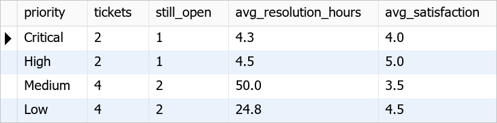

### Q19: Outstanding Invoices

List invoices that still have a balance due, from vw_invoice_balance.

```sql
-- Q19: money still to collect
SELECT invoice_number,
       account_name,
       due_date,
       total_amount,
       amount_paid,
       balance_due,
       status
FROM vw_invoice_balance
WHERE balance_due > 0
ORDER BY due_date;
```

*Money still to collect*

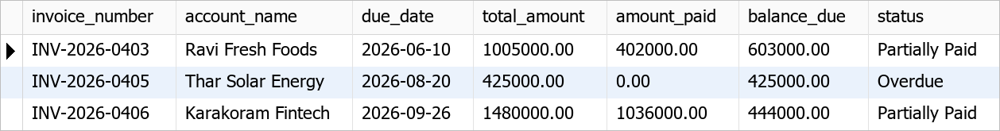


## 6. Stored Procedures, Trigger and Transactions

### Q20: Account Summary Procedure

Call sp_account_summary for Indus Weave Textiles (account 101). It returns two result sets.

```sql
-- Q20: account 360 + open deals for account 101
CALL sp_account_summary(101);
```

*Account 360 + open deals for account 101*

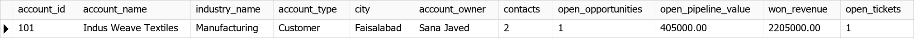

*Account 360 + open deals for account 101*

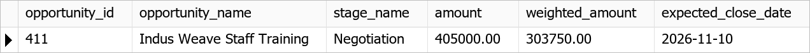

### Q21: Sales Rep Pipeline with OUT Parameters

Call sp_sales_rep_pipeline for Usman Tariq (user 4) and read the two OUT values.

```sql
-- Q21: OUT parameters
CALL sp_sales_rep_pipeline(4, @open_pipeline, @weighted_pipeline);

-- returned values
SELECT @open_pipeline AS open_pipeline,
       @weighted_pipeline AS weighted_pipeline;
```

*Returned values*

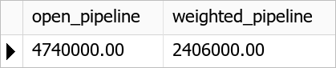

### Q22: Convert a Lead (Transaction)

Convert qualified lead 307 into an account, contact and opportunity in one transaction with sp_convert_lead.

```sql
-- Q22: convert lead 307
CALL sp_convert_lead(307, 'Gwadar Port ERP Implementation', 2400000.00, '2027-01-31', @new_opportunity);

-- lead is now Converted
SELECT lead_id, status, converted_account_id
FROM leads
WHERE lead_id = 307;

-- new account and contact
SELECT a.account_id, a.account_name, a.account_type, a.city,
       CONCAT(c.first_name, ' ', c.last_name) AS contact, c.is_primary
FROM accounts a
JOIN contacts c ON c.account_id = a.account_id
WHERE a.account_id = (SELECT converted_account_id FROM leads WHERE lead_id = 307);

-- new opportunity
SELECT opportunity_id, opportunity_name, account_name, owner_name, stage_name, amount
FROM vw_sales_pipeline
WHERE opportunity_id = @new_opportunity;
```

*Lead is now Converted*

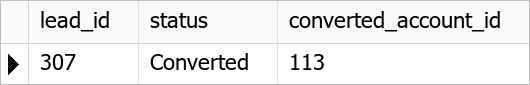

*New account and contact*

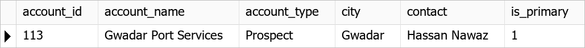

*New opportunity*

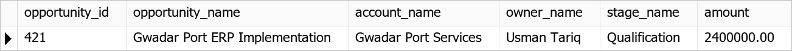

### Q23: Close a Deal as Won (Trigger + Auto Invoice)

Move opportunity 410 to Closed Won with sp_update_opportunity_stage. The trigger logs the stage change and the procedure raises the invoice in the same transaction.

```sql
-- Q23: Bilal Hassan (user 2) closes deal 410
CALL sp_update_opportunity_stage(410, 'Closed Won', 2, NULL);

-- stage history written by the trigger
SELECT h.history_id, f.stage_name AS from_stage, t.stage_name AS to_stage,
       u.full_name AS changed_by
FROM opportunity_stage_history h
LEFT JOIN pipeline_stages f ON h.from_stage_id = f.stage_id
JOIN pipeline_stages t      ON h.to_stage_id = t.stage_id
LEFT JOIN users u           ON h.changed_by = u.user_id
WHERE h.opportunity_id = 410
ORDER BY h.history_id;

-- invoice created automatically
SELECT invoice_number, account_name, total_amount, balance_due, status
FROM vw_invoice_balance
WHERE opportunity_name = 'Crescent Health ERP Phase 2';
```

*Stage history written by the trigger*


*Invoice created automatically*

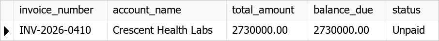

### Q24: Record a Payment (Transaction)

Record a part payment of PKR 1,000,000 against the new invoice with sp_record_payment.

```sql
-- Q24: part payment for the new invoice
SET @invoice_id = (SELECT invoice_id FROM invoices WHERE opportunity_id = 410);
CALL sp_record_payment(@invoice_id, 1000000.00, 'Bank Transfer', 'BT-26-0410A');

-- invoice is now Partially Paid
SELECT invoice_number, total_amount, amount_paid, balance_due, status
FROM vw_invoice_balance
WHERE invoice_id = @invoice_id;
```

*Invoice is now Partially Paid*

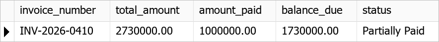

### Q25: Price What-If with SAVEPOINT

Test a price change inside a transaction: keep the training price rise, undo a mistaken software rise with ROLLBACK TO SAVEPOINT, then roll back the whole what-if.

```sql
-- Q25: prices before
SELECT product_code, category, unit_price
FROM products
WHERE category IN ('Training', 'Software')
ORDER BY product_code;

START TRANSACTION;

UPDATE products SET unit_price = unit_price * 1.05 WHERE category = 'Training';
SAVEPOINT training_price_updated;

UPDATE products SET unit_price = unit_price * 1.50 WHERE category = 'Software';

-- inside the transaction: both changes visible
SELECT product_code, category, unit_price
FROM products
WHERE category IN ('Training', 'Software')
ORDER BY product_code;

ROLLBACK TO SAVEPOINT training_price_updated;

-- after ROLLBACK TO SAVEPOINT: only the training rise remains
SELECT product_code, category, unit_price
FROM products
WHERE category IN ('Training', 'Software')
ORDER BY product_code;

-- it was only a what-if, so cancel everything
ROLLBACK;

-- after ROLLBACK: original prices
SELECT product_code, category, unit_price
FROM products
WHERE category IN ('Training', 'Software')
ORDER BY product_code;
```

*Prices before*

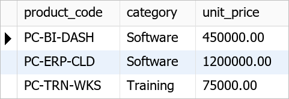

*Inside the transaction: both changes visible*


*After ROLLBACK TO SAVEPOINT: only the training rise remains*

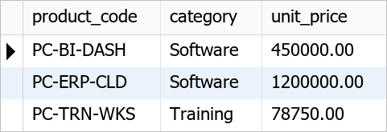

*After ROLLBACK: original prices*


## 7. Data Integrity Tests (expected to fail)

### Q26: Lead Score Above 100

Try to give a lead a score of 150. The CHECK constraint chk_leads_score must reject it.

```sql
-- Q26: lead score outside 0-100 (Expected: ERROR)
UPDATE leads SET lead_score = 150 WHERE lead_id = 317;
```

**Result:** rejected as expected

```text
Error Code: 3819. Check constraint 'chk_leads_score' is violated.
```

### Q27: Duplicate Contact Email

Try to add a contact with an email that already exists. The UNIQUE key must reject it.

```sql
-- Q27: duplicate email (Expected: ERROR)
INSERT INTO contacts (account_id, first_name, last_name, email)
VALUES (102, 'Test', 'Duplicate', 'asif.mahmood@indusweave.example');
```

**Result:** rejected as expected

```text
Error Code: 1062. Duplicate entry 'asif.mahmood@indusweave.example' for key 'contacts.uq_contacts_email'
```

### Q28: Deal for a Missing Account

Try to create an opportunity for account 999, which does not exist. The foreign key must reject it.

```sql
-- Q28: unknown account (Expected: ERROR)
INSERT INTO opportunities (opportunity_name, account_id, owner_user_id, stage_id, expected_close_date)
VALUES ('Ghost Deal', 999, 3, 1, '2027-01-01');
```

**Result:** rejected as expected

```text
Error Code: 1452. Cannot add or update a child row: a foreign key constraint fails (`pulse_crm`.`opportunities`, CONSTRAINT `fk_opportunities_account` FOREIGN KEY (`account_id`) REFERENCES `accounts` (`account_id`))
```

### Q29: Delete an Account that Has Deals

Try to delete account 101. The delete would cascade to its contacts, but activities, deals and tickets still reference them, so a foreign key blocks the whole delete and nothing is removed.

```sql
-- Q29: parent row still referenced (Expected: ERROR)
DELETE FROM accounts WHERE account_id = 101;
```

**Result:** rejected as expected

```text
Error Code: 1451. Cannot delete or update a parent row: a foreign key constraint fails (`pulse_crm`.`activities`, CONSTRAINT `fk_activities_contact` FOREIGN KEY (`contact_id`) REFERENCES `contacts` (`contact_id`))
```

### Q30: Overpayment Rejected by Procedure

Try to record a payment larger than the balance due. The procedure raises its own error and rolls back.

```sql
-- Q30: payment larger than the balance (Expected: ERROR)
CALL sp_record_payment(903, 99999999.00, 'Card', 'CARD-TEST-01');
```

**Result:** rejected as expected

```text
Error Code: 1644. Payment must be positive and cannot exceed the balance due
```

### Q31: Closed Lost without a Reason

Try to mark a deal as Closed Lost without giving a loss reason.

```sql
-- Q31: missing loss reason (Expected: ERROR)
CALL sp_update_opportunity_stage(411, 'Closed Lost', 3, NULL);
```

**Result:** rejected as expected

```text
Error Code: 1644. A loss reason is required for Closed Lost
```

### Q32: Converting an Unqualified Lead

Try to convert lead 322, which is Unqualified.

```sql
-- Q32: unqualified lead (Expected: ERROR)
CALL sp_convert_lead(322, 'Test Deal', 1000.00, '2027-01-01', @x);
```

**Result:** rejected as expected

```text
Error Code: 1644. Unqualified leads cannot be converted
```

